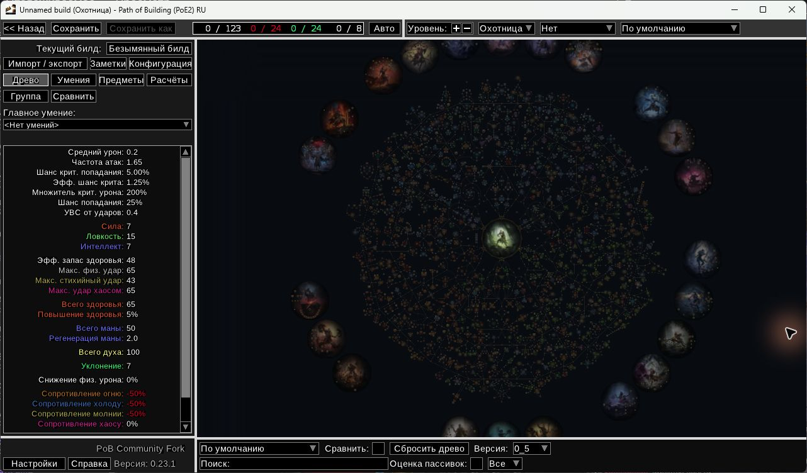
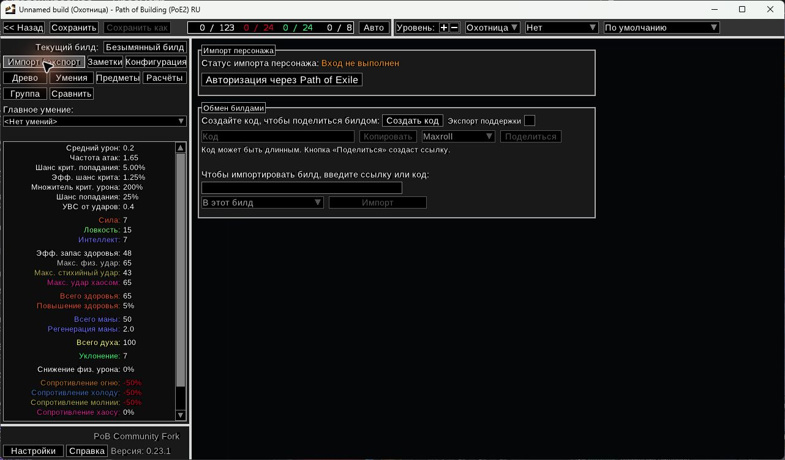

# Path of Building для PoE 2 — русская версия

Неофициальная русская локализация **Path of Building Community для PoE 2**. Интерфейс, дерево пассивных умений, камни и предметы используют названия и формулировки русского клиента игры.

**Первый публичный бета-выпуск:** `v0.23.1-ru.1-beta.1` · **PoB:** `0.23.1` · **игровые данные:** `PoE 2 0.5.5g`, Steam Build `26650308`.



## Скачать и запустить

1. Откройте [Releases](https://github.com/chehlao1989-oss/PathOfBuilding-PoE2-RU/releases).
2. Скачайте архив **PoB2-RU-0.23.1-ru.1-beta.1-Windows.zip**. Архивы GitHub «Source code» предназначены для разработчиков.
3. Распакуйте ZIP в отдельную папку с доступом на запись.
4. Запустите **Path of Building-PoE2.exe**. Установка и запущенная игра для работы со сборкой не требуются.

Билды и настройки сохраняются рядом с программой, в `Builds` и `Settings.xml`. Русский язык включён по умолчанию; переключение находится в **Настройки → Язык**. Обновления этой сборки публикуются в Releases этого репозитория. При обновлении распаковывайте новый архив отдельно и переносите нужные билды из `Builds`.

## Что переведено

- Интерфейс, расчёты, условия, предупреждения, импорт персонажа и окна торговли.
- Текущее дерево `0_5`: **4 544 названия и 6 056 строк свойств**, включая узлы Восхождения и доступные PoB скрытые узлы.
- **966 названий камней**, 398 видимых описаний активных умений, 566 описаний поддержки, строки уровня и качества.
- **1 753 названия баз** и названия **443 уникальных предметов**. Подключены официальные редкие имена, префиксы и суффиксы волшебных предметов, свойства и художественные описания.
- Поиск переведённых объектов по русскому и английскому названию, вставка предметов из русского клиента, названия эмоций для зачарования и вставляемых в гнёзда предметов.

Сопоставление игровых текстов выполняется по ID и контексту. Исходные ID, формат билдов и английские строки для расчётов и обмена сохраняются. Русская сборка принимает обычные коды PoB.

## Импорт персонажа и торговля

В **Импорт / экспорт** авторизуйтесь на сайте Path of Exile, выберите персонажа и импортируйте дерево с самоцветами, затем предметы и умения. Каждый пользователь входит в свой аккаунт самостоятельно.

Для поиска улучшений выберите главное умение, откройте **Предметы → Найти эти предметы на рынке** и нажмите **Подбор** у нужной ячейки. Задайте максимальную цену и уровень персонажа. Наведение на предложение показывает сравнение; **Импорт** добавляет и экипирует вещь в PoB. Вернуть прежнюю вещь можно через список соответствующей ячейки экипировки.

Используется штатная реализация авторизации и торговли PoB. Доступность функций зависит от сервисов GGG. Публичный идентификатор OAuth исходного приложения сохранён; отдельное одобрение этого форка со стороны GGG или разработчиков PoB не заявляется.



## Статус и ограничения

Это бета с зафиксированными версиями данных. Она не обещает совместимость с будущими обновлениями PoB или игры. Полный список ограничений и результатов проверки находится в [docs/QA-RU.md](docs/QA-RU.md), машинные отчёты — в [localization/coverage](localization/coverage).

- У 17 скрытых эффектов монстров пока нет подтверждённого русского описания. Имена всех камней переведены.
- Историческое дерево `0_4` переведено частично: 4 284 из 4 353 названий и 5 491 из 5 691 строки свойств.
- Две скрытые базы Energy Blade оставлены с исходными именами. Неизвестный текст и пользовательские названия могут сохранять оригинальное написание.
- У трёх исходных вариантов «Хватки Кулемака» отсутствует число — PoB показывает `…%`.
- Обычное обновление исходной PoB в этой сборке отключено, чтобы сохранить локализацию. Используйте выпуски данного репозитория.

## Сообщить об ошибке

Создайте [Issue](https://github.com/chehlao1989-oss/PathOfBuilding-PoE2-RU/issues) и приложите версию сборки, шаги воспроизведения, скриншот и при необходимости код тестового билда. Для расхождения с игрой полезны английское имя и карточка из русского клиента той же версии. Перед отправкой удалите личные данные. Файл `Settings.xml`, токены авторизации и ответы API к сообщению прикладывать не следует.

## Исходники и сборка

Русская ветка основана на [PoB v0.23.1](https://github.com/PathOfBuildingCommunity/PathOfBuilding-PoE2/tree/v0.23.1), коммит `7d6f530cbdab20389ff8bc6ba97a37ac27f74e41`. Локализованные исходники находятся в `src`, компоненты Windows — в `runtime`, каталоги — в `src/Data/Locale`.

Сборка переносимого архива из полного клона репозитория с Python 3.10+:

```powershell
python scripts/build_ru_release.py
```

Скрипт использует проверяемый список файлов и SHA-256, создаёт отдельную папку и ZIP, затем проверяет состав архива. Личные билды, настройки и ответы API в него не включаются. Порядок обновления локализации описан в [localization/README.md](localization/README.md).

## Авторы и лицензии

- Основная программа — [PathOfBuildingCommunity/PathOfBuilding-PoE2](https://github.com/PathOfBuildingCommunity/PathOfBuilding-PoE2), David Gowor и участники проекта. [Исходные лицензии](LICENSE.md) сохранены.
- Русская локализация, доработки интерфейса и проверка — [chehlao1989-oss](https://github.com/chehlao1989-oss), при разработке использовался Codex.
- Компоненты Unicode-отрисовки — [woolkingx/PathOfBuilding-PoE2-i18n](https://github.com/woolkingx/PathOfBuilding-PoE2-i18n), выпуск `v0.1.0`; [лицензия](LICENSE-i18n.md).
- Шрифт Liberation Sans — SIL Open Font License 1.1; текст лицензии включён в `runtime/SimpleGraphic/Fonts/Liberation-Fonts-OFL.txt`.
- Игровые названия и тексты принадлежат Grinding Gear Games. Источник русских формулировок — данные русского клиента указанной версии.

This product isn't affiliated with or endorsed by Grinding Gear Games in any way. This is an unofficial localization fork, maintained independently of the Path of Building Community team.

## English

Unofficial Russian localization of Path of Building Community for PoE 2, pinned to PoB 0.23.1 and game data 0.5.5g. Raw build identities, calculation inputs and trade API values remain in the upstream format. Download the Windows portable ZIP from Releases; see the Russian sections above for known limitations and build instructions.
